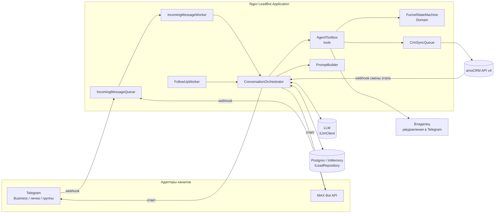
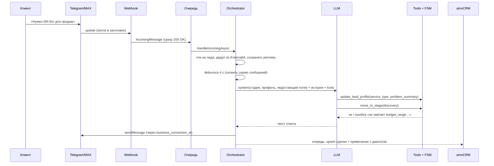
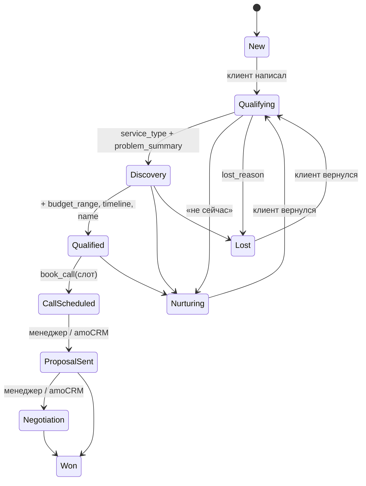

# LeadBot: архитектура

ИИ-бот для студии разработки ПО и внедрения ИИ. Он сам общается с клиентом в Telegram (личный аккаунт через Telegram Business, личка бота, группы) и в MAX, ведёт лида по воронке до созвона-брифа и синхронизирует всё с amoCRM.

## 1. Принципы

1. **Одно ядро и тонкие адаптеры.** Логика воронки не знает про мессенджеры. Telegram и MAX — это адаптеры, которые приводят апдейты к `IncomingMessage` и умеют отправить текст (`IChannelSender`). Новый канал (WhatsApp, VK, виджет на сайте) — это ещё один адаптер.
2. **LLM предлагает, код решает.** Модель ведёт свободный диалог и вызывает инструменты (`update_lead_profile`, `move_to_stage`, `book_call`…). Правила переходов, обязательные поля и проверку слотов делает детерминированная машина состояний `FunnelStateMachine`. Модель не может «перепрыгнуть» стадию или выставить «Сделка выиграна».
3. **Клиент никогда не ждёт CRM.** Синхронизация с amoCRM идёт через очередь с ретраями. Если amoCRM недоступна, ответ клиенту всё равно уходит.
4. **Человек всегда главнее бота.** Если владелец сам написал в чат из своего Telegram, бот замолкает (по умолчанию на 12 ч). Кнопки в уведомлении: «Вернуть боту» / «Забрать себе».
5. **amoCRM — источник истины для поздних стадий.** Сменили этап в amoCRM — вебхук переносит его к нам. Бот не откатывает сделку, которую менеджер перевёл в этап, неизвестный боту.

## 2. Компоненты



| Проект | Ответственность |
|---|---|
| `LeadBot.Domain` | `Lead`, `LeadProfile`, стадии, `FunnelStateMachine`. Без зависимостей, на 100% покрывается юнит-тестами. |
| `LeadBot.Application` | Оркестратор диалога, LLM-агент с инструментами, промпты, очереди, фоновые воркеры, порты (`ILeadRepository`, `IChannelSender`, `ILlmClient`, `ICrmGateway`, `IOwnerNotifier`, `ICallCalendar`). |
| `LeadBot.Channels.Telegram` | Bot API: Business-сообщения, личка, группы, кнопки владельца, регистрация вебхука. |
| `LeadBot.Channels.Max` | MAX Bot API (`platform-api.max.ru`): диалоги, групповые чаты, `bot_started`, подписка на вебхук. |
| `LeadBot.Crm.AmoCrm` | API v4: сделка и контакт (`/leads/complex`), примечания, задачи, OAuth или долгосрочный токен, приём вебхуков смены статуса. |
| `LeadBot.Llm.DeepSeek` | Реализация `ILlmClient` для DeepSeek (Chat Completions в формате OpenAI + function calling). Провайдер по умолчанию. Режим рассуждений выключен: с инструментами DeepSeek требует возвращать `reasoning_content` всех прошлых ходов. |
| `LeadBot.Llm.Anthropic` | Реализация `ILlmClient` (Messages API + tool use). Включается `Llm:Provider = Anthropic`. |
| `LeadBot.Infrastructure` | InMemory-репозиторий, календарь рабочих часов, системные часы, лог-уведомления. |
| `LeadBot.Persistence.Postgres` | EF Core + Npgsql: таблица `leads`, профиль, идентичность и история в `jsonb`. |
| `LeadBot.Api` | Хост ASP.NET Core: вебхуки `/webhooks/telegram`, `/webhooks/max`, `/webhooks/amocrm/{secret}`, `/health`. |

## 3. Поток сообщения



**Детали, которые легко упустить:**
- **Дедупликация.** Telegram и MAX повторяют вебхук, если ответ задержался. ID сообщения хранится в истории, повтор отбрасывается.
- **Debounce.** Клиенты часто пишут 3–4 коротких сообщения подряд. Бот ждёт `DebounceSeconds` и отвечает на всё одним сообщением.
- **Сериализация по лиду.** `KeyedLock` гарантирует, что один лид обрабатывается в один поток, а разные лиды — параллельно.
- **Эхо в Business.** Сообщения, которые отправил сам бот, приходят обратно как `business_message` с полем `sender_business_bot`. Они игнорируются. Сообщения, где `from.id` совпадает с владельцем подключения, считаются ответом менеджера.

## 4. Воронка



- Бот может выставлять: `qualifying`, `discovery`, `qualified`, `call_scheduled` (только через `book_call`), `nurturing`, `lost`.
- `ProposalSent`, `Negotiation`, `Won` выставляет только человек или amoCRM.
- **Автонапоминания.** Если клиент молчит `FollowUpAfterHours` и лид ещё не дошёл до созвона, бот пишет короткое напоминание. Максимум `MaxFollowUps` раз, потом лид переходит в `Nurturing`. В тихие часы напоминания не отправляются.
- **Передача человеку** (`handoff_to_human`): просьба клиента, недовольство, договор, оплата, нестандартная задача, неуверенность модели. Бот уведомляет владельца, создаёт задачу в amoCRM и замолкает.

### Инструменты агента

| Tool | Что делает | Проверки в коде |
|---|---|---|
| `update_lead_profile` | Сохраняет имя, компанию, роль, ЛПР, тип услуги, суть задачи, бюджет, сроки, телефон, email | Только непустые строки, enum услуги |
| `move_to_stage` | Смена стадии | Таблица переходов, обязательные поля, запрет «менеджерских» стадий |
| `get_call_slots` | Свободные слоты (рабочие часы, по 2 на день) | — |
| `book_call` | Бронь слота → `CallScheduled`, задача в amoCRM, уведомление владельцу | Слот в будущем, свободен, лид квалифицирован |
| `handoff_to_human` | Режим «человек», задача в amoCRM, уведомление | — |
| `schedule_followup` | Напоминание через N часов («напишите через месяц») | 1–2160 ч |

## 5. Каналы

### Telegram

| Сценарий | Как работает |
|---|---|
| Клиент пишет вам в **личный аккаунт** | Telegram Business: Настройки → Telegram для бизнеса → Чат-боты → выбрать бота. Нужен Telegram Premium. Бот получает `business_message` и отвечает с `business_connection_id`. В настройках лучше ограничить доступ: например, «только новые чаты» или исключить контакты, чтобы бот не отвечал друзьям и коллегам. |
| Клиент пишет **боту** | Обычная личка, `/start <payload>` — источник лида. |
| Вопрос в **группе** | Бот реагирует на упоминание, ответ на своё сообщение или ключевые слова. Воронку при всех не ведёт: отвечает коротко и даёт кнопку «Написать в личку» (deep-link). Вопрос из группы запоминается и попадает в контекст, когда клиент открывает личку. Боту нужны права администратора или выключенный privacy mode в @BotFather. |
| **Уведомления владельцу** | В личку владельца с ботом (`OwnerChatId`), с кнопками «Вернуть боту» / «Забрать себе». |

⚠️ Бот, подключённый через Business, может отвечать только в чатах, где была активность за последние 24 часа. Поэтому `FollowUpAfterHours` по умолчанию 20. Более поздние напоминания в Business-чатах не дойдут: это видно в логах, а владелец получит уведомление.

### MAX

- Бот создаётся через @MasterBot и платформу MAX для партнёров. Создать бота может только юрлицо или ИП (РФ) после верификации.
- Токен передаётся в заголовке `Authorization`, базовый URL `https://platform-api.max.ru`. Вебхук регистрируется через `POST /subscriptions` с `secret`, MAX возвращает его в заголовке `X-Max-Bot-Api-Secret`.
- Аналога Telegram Business нет: клиент пишет боту или в чат, куда бот добавлен.
- ⚠️ DTO написаны по документации на момент разработки. Перед запуском сверьте поля с https://dev.max.ru/docs-api: API молодой и меняется.

## 6. amoCRM

**Авторизация** (одна из двух):
- **Долгосрочный токен** приватной интеграции (`LongLivedToken`) — проще всего для своего аккаунта.
- **OAuth 2.0.** Access-токен живёт около 24 ч, refresh одноразовый и ротируется. Свежая пара сохраняется в `TokenFile`.

**Что синхронизируется:**

| Событие у бота | Действие в amoCRM |
|---|---|
| Новый лид | `POST /api/v4/leads/complex`: сделка + контакт + теги (`бот`, канал) |
| Изменились профиль или стадия | `PATCH /leads/{id}` (имя, поля, статус), `PATCH /contacts/{id}` (телефон, email) |
| Каждый ход диалога | Примечание «Клиент: … / Бот: …» |
| Ответ менеджера из Telegram | Примечание «Менеджер: …» |
| `book_call` | Задача «Созвон-бриф» на время слота |
| `handoff_to_human` | Задача «Бот передал диалог» (срочная — 15 мин) |

**Обратная синхронизация.** Настройки → Интеграции → Web hooks → `https://<host>/webhooks/amocrm/<WebhookSecret>`, событие «Смена статуса сделки». Статус через `StatusMap` переводится в стадию бота с источником `Crm`. Эхо от наших же изменений ничего не меняет: переход в ту же стадию — no-op.

**Настройка:**
1. Создайте воронку и этапы под стадии бота. Их `status_id` впишите в `AmoCrm:StatusMap`. `Won`=142 и `Lost`=143 — системные.
2. Создайте поля сделки («Бюджет», «Сроки», «Тип услуги», «Суть задачи», «Источник», «Канал», «Созвон») и впишите их `field_id` в `AmoCrm:LeadFields`. Значение 0 — поле не синхронизируется.
3. ID этапов и полей: `GET /api/v4/leads/pipelines` и `GET /api/v4/leads/custom_fields`.
4. Ограничение amoCRM — 7 запросов/с. Клиент троттлит до примерно 6/с.

**Этап 2.** Показывать переписку в карточке amoCRM как чат (amoCRM Chats API / «Каналы»), а не примечаниями. Тогда менеджер отвечает прямо из amoCRM, и ответ уходит клиенту через бота.

## 7. Конфигурация и запуск

```bash
dotnet user-secrets init --project src/LeadBot.Api
dotnet user-secrets set "Telegram:BotToken" "..." --project src/LeadBot.Api
dotnet user-secrets set "Llm:Anthropic:ApiKey" "..." --project src/LeadBot.Api
# ... остальные секреты аналогично
dotnet run --project src/LeadBot.Api
```

- Для вебхуков нужен публичный HTTPS. Локально — туннель (cloudflared, ngrok и т.п.), его адрес — в `PublicBaseUrl`.
- `OwnerChatId` — ваш Telegram user id. Сначала напишите своему боту `/start`.
- Описание компании, услуг и ориентиров цен — `src/LeadBot.Api/prompts/company.md`. Бот опирается только на него.

## 8. Ограничения каркаса и путь в прод

| Сейчас | Для прода |
|---|---|
| InMemory-репозиторий | `LeadBot.Persistence.Postgres` (+ миграции, ретрай при конфликте `xmin`) |
| Очереди in-memory (`Channel<T>`) | Outbox-таблица для CRM, брокер для входящих (если несколько инстансов) |
| `KeyedLock` в процессе | Один инстанс или распределённая блокировка (Redis) |
| Календарь рабочих часов в памяти | Google Calendar / Яндекс Календарь (CalDAV), ссылка на встречу |
| Только текст | Голосовые → распознавание речи (Whisper / SpeechKit), файлы → извлечение текста |
| Нет админки | Простой дашборд по лидам и диалогам, ручная правка профиля |
| Тесты домена | Интеграционные тесты оркестратора с фейковым LLM, eval-набор диалогов для промпта |

**Безопасность и право:**
- Секреты хранить в user-secrets или переменных окружения, не в `appsettings.json`.
- Вебхуки проверяют секрет в заголовке или URL.
- Персональные данные клиентов из РФ — 152-ФЗ: хранить на сервере в РФ, иметь политику обработки ПД. История диалога уходит в LLM-провайдера — учтите это в политике. DeepSeek обрабатывает данные на серверах в Китае — для персональных данных из РФ это трансграничная передача. Если это критично, используйте провайдера с размещением в РФ (GigaChat, YandexGPT) через свою реализацию `ILlmClient`.
- Бот честно говорит, что он ИИ-ассистент, если его прямо спросят.
